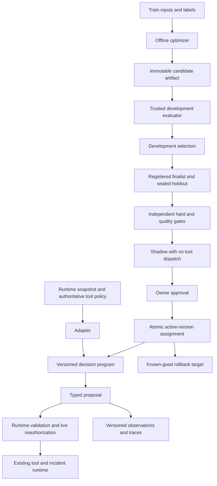

# Metric-driven optimization architecture

**Status:** Phase 0 design finalized; Phase 1 baseline, validation and scoring
implemented, 2026-10-11. The [Phase 1 review](docs/phase-1-review.md) distinguishes
working code, the recorded Qwen3 local check and pending dataset review. Later components
below remain design requirements, not deployed behavior.
The [Notion guided build](https://app.notion.com/p/3e8456c5513581f89164d6f511de8f70)
is the curriculum source; the versioned contracts below settle this project's
initial engineering choices.

The application now has a [model provider strategy](docs/model-providers.md) for
the verified local Ollama adapter and an explicit `.env`-selected OpenRouter
model. The generalized client is separate from the frozen local benchmark;
remote benchmark admission is not implemented. Provider tests use mocked HTTP,
and no live OpenRouter call has been made.

## Purpose and first target

Improve the incident investigator's **next-action selection** through offline
experiments. A decision program receives one incident snapshot, evidence,
hypotheses, runtime-supplied tool options and remaining budgets. It proposes a
typed decision. The existing runtime retains authorization, approvals,
idempotency, actual tool execution and incident lifecycle control.

In an illustrative checkout incident, a candidate might select a pool diagnostic
sooner than the fixed baseline. The evaluator must still reject a denied restart
proposal, including one the runtime successfully blocks. A smaller prompt or
higher average score cannot compensate for that violation. The
[complete case](docs/dataset-schema.md#5-complete-illustrative-case) and
[scoring example](docs/metrics.md#4-worked-accounting-example) make those outcomes
concrete; no results have been measured yet.

The first suite scores one decision at a time. It does not claim incident
resolution, root-cause discovery, or real tool efficiency. Those require a later
versioned episode suite and runtime integration. Project 1 is not present here;
this project defines its own adapter boundary and requires conformance evidence
before it can replace any component in that runtime.

## Normative documents

| Document | Owns |
| --- | --- |
| [ADR-001](docs/adr/001-optimization-boundary.md) | Optimizer write boundary and candidate configuration allowlist |
| [ADR-002](docs/adr/002-metric-hierarchy.md) | Scoring authority and constraints before objectives |
| [ADR-003](docs/adr/003-dataset-splits-and-leakage.md) | Data access and holdout contamination rules |
| [Baseline contract](docs/baseline-contract.md) | DecisionRequest, ActionDecision, exact baseline prompt, execution/failure contract |
| [Dataset schema](docs/dataset-schema.md) | Case/manifest fields, serialization, labels and split validation |
| [Metric contract](docs/metrics.md) | Metric formulas, missing-data rules, paired analysis and gate profile |
| [Phase 0 review](docs/phase-0-review.md) | Acceptance evidence and remaining implementation prerequisites |

These documents form specification v1. Explicit field/metric definitions take
precedence over explanatory examples. Any contradiction is a specification
error to resolve before execution, not an invitation to choose a convenient
interpretation. Changing a contract, label policy, or gate produces a new version.

## Runtime path and offline path

A candidate is data: approved instruction text, train demonstrations and bounded
parameters. It is not arbitrary Python, an executable pickle, an installation
script or a new tool. Reject unknown artifact fields and verify its digest before
loading. The optimizer has no write credentials for policies, evaluation labels,
registry approval records or deployment assignments.

The optimizer may inspect training data. It submits immutable candidates to a
trusted evaluator for development scores; model invocations receive only case
inputs. Holdouts are served under a separate evaluator identity and are not
mounted into the optimizer environment. Separate directories or a convention
inside a shared Python process do not establish this boundary. No isolation
mechanism has been implemented yet.

## Component responsibilities

| Area | Responsibility | Must not own |
| --- | --- | --- |
| `apps/decision_program` | Frozen prompt/control, typed decision, renderer, version and runtime adapter | Tool execution or promotion authority |
| `apps/evaluation` | Validate manifest, schedule paired attempts, retain failures, aggregate observations and uncertainty | Candidate mutation or policy changes |
| `apps/evaluation/metrics` | Independent deterministic labels, policy checks, usage and scalar adapter | Reinterpret a violation as a tolerable penalty |
| `apps/evaluation/judges` | Future bounded ambiguous-criterion judgment and calibration | Safety/correctness override |
| `apps/optimization` | Generate allowed candidate data, record lineage and budgets, request evaluation | Read sealed data or activate its own result |
| `apps/mlflow_integration` | Experiments, traces, artifacts, evaluation views and prompt versions | Authoritative deployment pointer |
| `apps/inspect_eval` | Independently implement frozen holdout scoring against the same specification | Import the primary scorer and call agreement independent |
| `apps/telemetry` | Correlated traces, task/optimizer usage, clocks and version attributes | Supply missing measurements as zeros |
| `apps/control_plane` | Transactional lifecycle records, gates, activation and rollback | Infer permission from an MLflow tag or model output |

DSPy supplies baseline/comparison modules and later MIPROv2/GEPA experiments.
The task model, optimizer/reflection model and optional judge are distinct roles
with separately recorded identities and usage. Model credentials/roles do not
confer tool authorization. Predict and ChainOfThought comparisons are separate
frozen program profiles; DSPy ReAct must not replace the existing runtime.
Optional Optuna, Phoenix/OpenInference, TextGrad, Ax/BoTorch and evaluator
extensions stay outside the initial implementation scope.

## Persistence and reproducibility

PostgreSQL owns dataset/program versions, optimization runs, candidate
evaluations, judge versions, promotion decisions and deployment assignments.
MLflow owns rich experiment artifacts and traces. Content digests connect them;
neither a mutable MLflow alias nor a tracking tag can authorize activation.
These are logical ownership decisions, not SQL schema or migrations.

A release records prompt/renderer/code/configuration hashes, model weight and
tokenizer identities, tool/runtime policy, dataset/manifest, scorer and gate
versions, seeds, backend, hardware, concurrency and dependency lockfile hash.
Persist raw observations and metric components, not just the winning scalar.
Record known actual usage separately from estimates and separately for each
model role. A replay can reconstruct the experiment; identical stochastic
outputs are not guaranteed.

Write artifacts to staging, verify and durably store them, then register their
hashes. A missing artifact or failed tracking write leaves a run incomplete and
ineligible; an orphaned staged artifact is not an approved candidate. Registration
and activation use explicit IDs. Approval plus deployment pointer update and
rollback target are a single database transaction with a compare-and-set against
the expected active version. A race or stale approval aborts rather than
silently overwriting another promotion. Database schema and code are not
optimizer-controlled.

## Lifecycle, budgets and failure ownership

The candidate lifecycle is `generated -> dev_evaluated -> holdout_passed ->
shadow -> promoted`, with `rejected`, `inconclusive`, `interrupted`, `rolled_back`
and `archived` as explicit outcomes. Gate evidence accompanies every transition.
A failed or interrupted run cannot supply a partial candidate for activation.
Superseding a version archives it without deleting replay or rollback evidence.

The [gate profile](docs/metrics.md#6-selection-and-promotion-profile-v1) fixes the
v1 quality, resource and shadow requirements. Only the owner approves production
activation. A runtime safety violation halts/rolls back; unavailable rollback
artifacts require a halt and human intervention, not an improvised model fallback.

Every evaluation/optimization run must carry an immutable BudgetPlan with
nonnegative integer ceilings for generated candidates, task-model calls,
optimizer-model calls, total input tokens, total output tokens and wall-clock
milliseconds. The wall-clock ceiling must be positive; a zero resource limit
explicitly forbids that operation. Evaluation-only runs set candidate generation
and optimizer-model calls to zero. Evaluation also declares its exact cases,
replicates, warm-up and concurrency. No unbounded/default-infinite value is valid.
Values are selected
and recorded before the particular campaign starts, never increased by its
optimizer. The fixed per-decision ceiling is 8,192 input tokens, 512 output tokens
and 30 seconds, reduced by runtime remaining allowances.

Before dispatch, reserve the configured worst-case input/output and call quota
atomically, then reconcile actual measured use. Include failed calls, warm-up,
compiler probes, reflection and all model roles. Stop when another call cannot
be reserved; record unknown usage conservatively against its reservation. A
wall-clock timeout cancels further work and prevents promotion even if a late
provider response arrives. This is a requirement for future accounting, not a
claim that installed libraries already enforce it.

## Implementation boundary after Phase 1

Phase 1 supplies the baseline core and frozen implementation bytes, strict
validators, deterministic scorers, a sequential runner and 100 synthetic draft
cases. The selected Qwen3 adapter has completed local conformance verification,
with five schema-invalid baseline outputs recorded. Independent label review
remains pending; see the [review](docs/phase-1-review.md). Paired statistics,
judges, optimizer modules, persistence and promotion remain deferred. Do not run
an optimizer before the earlier guided review gates have been satisfied.

Actual model/digest/license selection, the real dataset release and its review,
benchmark hardware binding, and Project 1 adapter conformance are execution
prerequisites. Their values must be supplied honestly during the relevant phase;
this specification does not fabricate models, dataset hashes, reviews or results.
