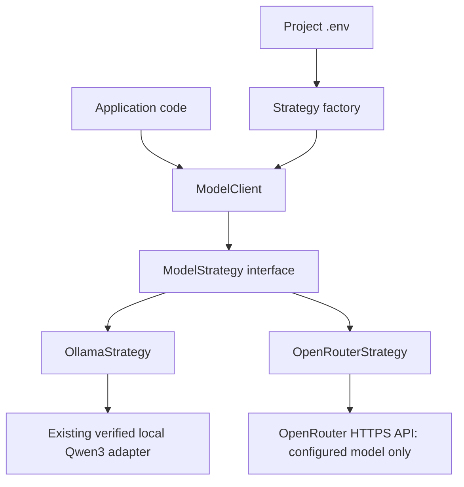

# Swappable model providers

The provider strategy lets application code use the same interface with local
Ollama or remote OpenRouter. Configuration selects the strategy once, when the
client is created. Changing the file takes effect when a new client is created.
There is no per-request model argument and no automatic provider switch.



## Configuration

Copy [the example](../.env.example) to `.env` in the project root. `.env` is
ignored by Git. The loader reads only that file: shell variables, parent `.env`
files, variable interpolation and the reserved `TASK_MODEL`, `OPTIMIZER_MODEL`
and `JUDGE_MODEL` settings do not choose the model.

Local configuration:

```dotenv
LLM_PROVIDER=ollama
OLLAMA_BASE_URL=http://127.0.0.1:11434
OLLAMA_MODEL=qwen3:14b
```

Ollama currently supports the existing verified `qwen3:14b` binding at that local
URL. Other models and URLs are rejected rather than silently using a different
binding. Model weights, tokenizer, license and server checks remain in the
existing adapter. No models are downloaded and no services are started.

For OpenRouter, change the file to:

```dotenv
LLM_PROVIDER=openrouter
OPENROUTER_MODEL=vendor/model-id
OPENROUTER_API_KEY=your-api-key
```

`vendor/model-id` and `your-api-key` are placeholders to replace. There is no
chosen OpenRouter model or API key in the repository. Missing values cause a
configuration error before any request. Automatic routers such as
`openrouter/auto`, model lists, wildcards and presets are rejected. The configured
slug must match the response model exactly; aliases that return a different
canonical model ID are rejected, without retrying or changing configuration.

The implementation makes one non-streaming call to OpenRouter's
[chat completion endpoint](https://openrouter.ai/docs/api/api-reference/chat/create-a-chat-completion).
It sends only the configured `model`, disables provider fallbacks, and requires
support for requested generation parameters using the documented
[provider routing settings](https://openrouter.ai/docs/guides/routing/provider-selection).
Unsupported models/settings therefore fail rather than silently dropping settings.
There are no SDK retries, model fallback lists, redirects, response repairs, tool
execution, or automatic continuation calls. Provider errors exclude response
bodies, request contents and keys from their error messages.

## Use the shared interface

From the project directory, validate configuration without contacting a service:

```bash
.venv/bin/python -m scripts.run_model --check
```

Application code uses the same client for either selection:

```python
import asyncio

from apps.decision_program.baseline import Message
from apps.decision_program.model_strategy import ModelClient

client = ModelClient.from_env_file()
result = asyncio.run(client.generate((
    Message("system", "Reply briefly."),
    Message("user", "Reply with OK."),
)))
print(result.identity, result.completion.text)
```

For an incident request, pass `render_request(request)` from `baseline.py` to
`client.generate(...)`. This reuses the renderer without changing the frozen
prompt. The client returns model text; callers still need `parse_decision` and
`assess_policy` before treating it as a usable incident decision.

An opt-in command also accepts a JSON file with exactly one system and one user
message, in that order:

```json
[
  {"role": "system", "content": "Reply briefly."},
  {"role": "user", "content": "Reply with OK."}
]
```

```bash
.venv/bin/python -m scripts.run_model --messages /absolute/path/to/messages.json
```

This command makes a real model call and prints the response plus provider,
model, token usage and response metadata. With OpenRouter selected, the messages
are sent remotely and the call can incur charges. It is a transport entry point,
not an incident tool executor or benchmark. It has no `--model` option.

## Measurement boundary

Both strategies use temperature zero, top-p one, one seed, an output limit of at
most 512 tokens and a deadline of at most 30 seconds. `GenerationOptions` can
lower the output/time limits or select the seed, but cannot select a model.
The client applies an overall asynchronous deadline. Seeds do not establish
determinism across providers or runs. Truncated text is retained with finish
reason `length`; callers must not treat it as a complete decision automatically.

Ollama supplies an exact local input-token preflight, enforcing the 8192-token
allocation. OpenRouter has no locally bound tokenizer here, so
`preflight_input_tokens` is `null`; its input size is not checked against that
local allocation before sending. Usage comes from the response and missing usage
remains `null`. No extra inference or token-counting request is made. Remote
weights, tokenizer hashes and reproducibility guarantees are not fabricated.

The frozen baseline, original freeze manifest, concrete Ollama execution binding
and `scripts.run_baseline` are unchanged. The generalized client is a separate
application boundary; it does not qualify OpenRouter for that exact-token,
local-weight-bound benchmark. A future remote evaluation contract would need
explicit input-budget and execution-identity rules before using the existing
evaluation runner with a remote model.

## Verification

`tests/unit/test_model_strategy.py` checks file-only selection, both strategies,
request model and routing restrictions, usage, deadlines, malformed responses,
model mismatches and sanitized failures. All remote HTTP calls are mocked; no
live OpenRouter performance or correctness result is claimed. The implementation
reuses installed `httpx`, `python-dotenv` and Pydantic; no dependency was added.
